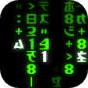

# Matrix mode

The green code rain from *The Matrix* on the **Nokia 8110 4G** (KaiOS 2.5 / GerdaOS).



## What it does

- **Opening**: "Call trans opt: received..." and "Trace program: running", with the traced number
  locking in digit by digit. Then the rain starts streaming down from a black screen, middle
  columns first.
- **Code rain**: the real glyph set (mirrored katakana plus the film's digits and symbols). As in
  the film the glyphs stay in place: waves of light travel down each column, with a near-white
  head and a green trail that fades out, while the glyphs keep changing. A soft glow sits on top.
- **Wake up, Neo**: the lines from Neo's screen, typed out with a blinking block cursor, ending on
  "Knock, knock, Neo."
- **Morpheus calls**: an incoming call screen that rings and vibrates. Answer it to hear what he
  has to say.
- The screen stays on while the app is open, so it works as a screensaver.

## Keys

| Key | Action |
|-----|--------|
| `5` / OK | Pause / resume |
| Up / Down | Speed (0.25x to 2x) |
| `*` | Glyph size (10, 12, 14, 16 px) |
| `#` | Glow on / off |
| `0` | Show the keys |
| `1` | Wake up, Neo |
| `2` | Morpheus calls (Call or OK answers, Back rejects) |
| `3` | Replay the trace |
| Back | Leave a scene; in the rain, close the app |

Speed, glyph size and glow are remembered.

## How it works

The rain is a port of the "classic" version of [Rezmason/matrix](https://github.com/Rezmason/matrix),
moved from WebGL shaders to plain ES5 and a 2D canvas, because Gecko 48 on this phone is too slow
for the original.

- `app/js/rain.js` is the model. Each column has a brightness wave,
  `1 - fract(wobble((row * k + columnTime) / length))`, and the cell where it wraps is the bright
  head ("cursor"). Glyphs cycle about twice a second. The opening has its own per-column timing, as in
  the original's intro shader. There is no DOM in it, so it is unit tested in node.
- `app/js/render.js` cuts `img/glyphs.svg` into a strip of glyph masks once at start-up. It
  pre-tints that strip in 24 greens and 8 head colours, then draws each lit cell with one
  `drawImage`. The glow is the frame shrunk to 1/4 and 1/8 size, then added back on top with
  `lighter`, which blurs it cheaply.
- `app/js/scenes.js` holds the text scenes as timelines; `app/js/main.js` handles the loop, keys,
  the ringtone (Web Audio, 440 + 480 Hz) and vibration.

It runs at about 20-28 fps on the phone with the glow on.

## Build and install

Needs a rooted phone with adb (GerdaOS, or KaiOS with root):

```
npm test               # unit tests (node --test)
npm run build          # dist/application.zip
npm run install-phone  # push, register, restart b2g
npm run uninstall-phone
```

The app needs no special permissions.

## Credits

The glyph artwork (`app/img/glyphs.svg`) and the rain algorithm come from
[Rezmason/matrix](https://github.com/Rezmason/matrix), MIT License, Copyright (c) 2018 Rezmason.
This is a fan project, not affiliated with Warner Bros.

## Licence

MIT, see [LICENSE](LICENSE).
